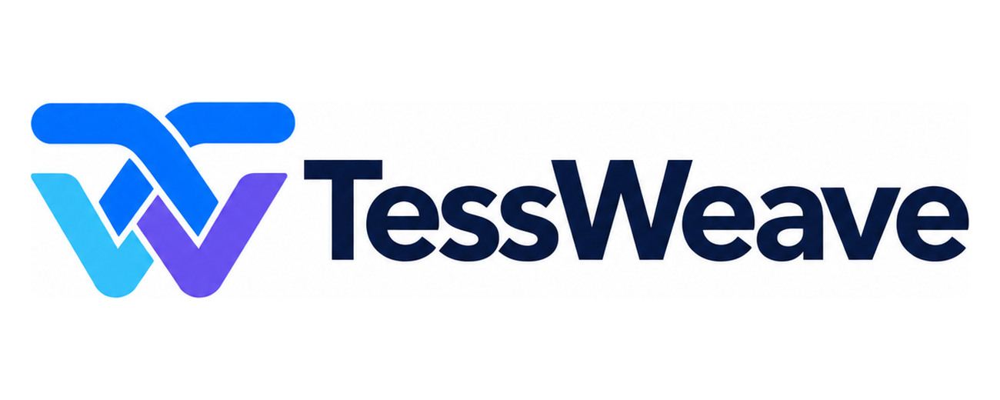

# TessWeave identity and compatibility

**TessWeave** combines the idea of a tessellated tensor tile with weaving an execution path. **Engine** identifies the independent inference runtime; **Studio** identifies the visual model-engineering control plane.

The current identity is the user-supplied interwoven T/W symbol in blue, cyan and
violet, with a dark navy **TessWeave** wordmark on white. It replaces the earlier
forward-chevron design. Repository documentation and the Studio sidebar use the
same image, without redrawing or substituting a different symbol.

- Canonical image: [`workbench/static/tessweave-brand.jpg`](../workbench/static/tessweave-brand.jpg), 1300 × 520 pixels. README and the Chinese user guide reference this file directly; there is no separate documentation copy to drift out of date.
- Display the complete image at its original aspect ratio. Preserve its white background, spacing, symbol and wordmark; do not stretch it or recolor it for a dark panel. This JPEG is not a vector or transparent-background asset.
- Coordinated UI colors: navy `#071536`, blue `#0068E8`, cyan `#27C1EC`, violet `#7045ED`. These are interface design tokens, not a claim that every gradient pixel has these exact values.
- `assets/brand/mark.svg`, `assets/brand/banner.svg` and `workbench/static/tessweave.svg` are **legacy chevron assets**, retained for existing paths only. Do not use them in new documentation or as the current logo. The historical SVG endpoint does not define the current identity.

Use the supplied identity consistently; do not imply upstream vendor endorsement,
unmeasured speedups or trademark clearance. Repository licensing is not a
trademark registration or a guarantee of name/domain availability. Interface
screenshots are demonstrations, not live GPU telemetry or deployment certification.

## Compatibility

| Display name | Repository | Existing command/module |
| --- | --- | --- |
| TessWeave Engine | `Felixgithub2017/tessweave-engine` | `flow-inference`, `python -m flow_engine.cli` |
| TessWeave Studio | `Felixgithub2017/tessweave-studio` | `model-workbench`, `python -m workbench` |
| TessWeave Train | `Felixgithub2017/tessweave-train` | `tessweave-train`, `python -m tessweave_train.cli` |

On 2026-10-08, the GitHub repositories were renamed from `flow-inference` and `model-workbench` to `tessweave-engine` and `tessweave-studio`. Local checkout folders, imports, state, metrics and existing CLI commands remain unchanged. Historical logs, filenames and the system-report draft may retain “Flow Inference” or “Model Workbench”; these refer to the same respective projects. The projects do not require one another to be installed. Train integration remains a roadmap item.
